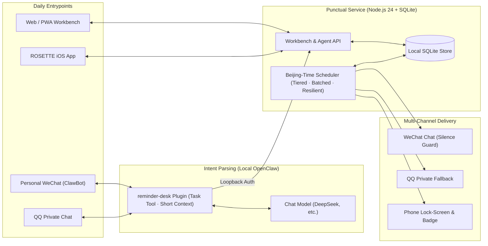

<div align="center">
  
  <h1>ROSETTE</h1>
  <p><strong>Personal Task & Multi-Channel Reminder Workbench</strong></p>
  <p>Capture tasks naturally in WeChat, receive punctual alerts across WeChat, QQ, and iPhone lock-screen notifications, and manage everything in the Web/PWA workbench or native SwiftUI iOS app.</p>
  <p><a href="./README.md">简体中文</a> · <strong>English</strong></p>
</div>

---

## Prerequisites & One-Shot AI Agent Deployment

> **Hardware & Network Requirement**: Because ROSETTE needs to stay online 24/7 to listen for WeChat messages and fire scheduled reminders on time, you need your own **Linux cloud server (VPS)** or an **always-on, internet-connected computer / mini-PC / NAS** (a valid HTTPS certificate on your public endpoint is required if you want iPhone Home-Screen PWA lock-screen push notifications).

### Prompt to copy into your agent

Send the entire block to a coding agent with terminal access and permission to reach the deployment host. Fill in any details you already know. For first-time setup, complete model authorization in a secure terminal, scan the WeChat QR code on your phone, and grant notification permission if you want phone alerts.

```text
Deploy ROSETTE on my behalf. Carry out the setup, troubleshooting, and automated checks through handoff. Continue any independent work while waiting for me. When I need to scan a QR code, authorize a model, change DNS, or grant phone notifications, show me the exact screen or command, what success looks like, and how to signal you to resume.

Deployment inputs (fill in what you know)
- ROSETTE source directory or Git repository URL and branch:
- Deployment target: this Linux machine, or a Linux host via an SSH alias or user/address
- Full public HTTPS workbench URL, including the path and trailing slash, e.g. https://example.com/reminder/:
- OpenClaw model provider and model (reuse the configuration of a dedicated instance if available):
- Optional scope: QQ fallback and/or an iOS build (default: web, WeChat, and PWA)

1. Use the supplied source directory, or clone the specified Git repository and branch. Read README.en.md, .env.example, package.json, deploy/, and openclaw-plugin/. Check the source revision, target OS and architecture, SSH and sudo access, free ports, existing reverse proxy, and TLS. Gather any missing inputs you cannot determine in one question. Linux with systemd is the baseline for these service templates. On Windows or NAS hosts, first identify an always-on Linux environment with a working network entry point. For upgrades, back up the actual database, configuration, and dedicated gateway state, and record how to roll back.

2. Set up Node.js 24, run npm ci to install locked dependencies, and run npm test. Use a dedicated low-privilege service account. Keep application files, database, and configuration in separate locations. Generate APP_PASSWORD, SESSION_SECRET, AGENT_TOKEN, and VAPID keys on first setup or when fields are missing, and configure VAPID_SUBJECT. Preserve existing credentials and VAPID keys. Store secrets in restricted configuration or let me enter them in a secure terminal. In the handoff, give me the local command to retrieve my login password. Show paths and status in reports and logs.

3. Adapt deploy/reminder.service and the Caddy/Nginx templates to the target paths, permissions, and ports. Use deploy/README.md and deploy/reminder-openclaw.service to configure the dedicated gateway. Bind the application and dedicated OpenClaw gateway to loopback and enable both services in systemd. Use the HTTPS scheme, host, and optional port for APP_ORIGIN. Set the subpath in the proxy. For subpath deployment, verify URL rewriting, cookie Path, static assets, manifest, and service worker scope. Make the public proxy reject /api/agent/* at the public mount path and validate the config before reloading.

4. Give ROSETTE its own OpenClaw state directory, port, and workspace. Check version compatibility using the repository-tested OpenClaw 2026.11.5 and WeChat plugin @tencent-weixin/openclaw-weixin@2.4.10 as a baseline. Link openclaw-plugin into the dedicated gateway, select its reminder-desk context engine, enable its conversation hooks, allow only reminder_tasks, apply the matching WeChat adapter, and sync deploy/openclaw/agent-workspace/. Connect both services to the same dedicated gateway and state directory. Set the gateway's REMINDER_AGENT_TOKEN to match the app's AGENT_TOKEN and set OPENCLAW_SEND_VIA_GATEWAY=true. If the app uses a port other than 3100, update the reminder plugin's apiBase and check the WeChat adapter's internal URL. Guide me through configure --section model in the dedicated instance when authorization is needed. Reuse valid credentials and verify the effective provider and model.

5. Run channels login --channel openclaw-weixin against the same state directory. Ask me to scan the QR code and send a message from my WeChat account. Set WECHAT_TARGET to the recipient userId and WECHAT_ACCOUNT to the bot account ID from the binding. Configure the reminder plugin's recipient and the gateway's ownerAllowFrom. If multiple candidates or an existing binding conflict, ask me to select the intended account. Resume binding, validate the configuration, and restart the relevant services. Set up QQ or build iOS only when requested. For QQ, use the repository-tested QQ plugin 2.0.4, bind my private chat OpenID, and verify Test Backup Chain. For iOS, use the full workbench URL for ReminderAPI.productionURL and follow ios/README.md for build and signing.

6. Verify each layer. Check both systemd units are running and enabled at boot, local and public /healthz, TLS, actual browser login and task creation, and public proxy rejection of /api/agent/*. Ask me to send a WeChat request for a check-in reminder two minutes from now. Confirm the model reply, corresponding web task and processing trace, then check that the reminder reaches WeChat at the scheduled time and appears in the delivery log. For PWA notifications, guide me to open the workbench from the iPhone Home Screen, enable notifications in Settings, and run Test Mobile to check the lock-screen alert and badge. Clean up the test tasks you created and preserve real data. Report each check as passed, pending my verification, or blocked, with evidence.

Finish with a runbook tailored to this deployment. Include the workbench URL, how to retrieve the password and sign in, how to create and edit tasks from WeChat, how to enable iPhone notifications, where to find delivery records, and copyable service status, logs, restart, backup, and rollback commands. For any blocked check, give me the exact next action and success indicator.
```

---

## Why ROSETTE? (Real-World Pain Points & My Solutions)

Anyone who tries to use a personal WeChat bot or an LLM agent as a daily reminder assistant quickly runs into several frustrating real-world limitations. ROSETTE was built specifically to solve them:

### Pain Point 1: WeChat Can Reject Scheduled Reminders After Quiet Periods
- **The Problem**: Tencent's official personal WeChat bot channel (ClawBot / iLink) relies on a session token tied to your last inbound message. When the session credential expires or a platform limit applies, scheduled reminders can come back with a rejection such as `-2 / prepare failed`.
- **My Solution**:
  1. **Proactive Silence & Quota Guard**: ROSETTE tracks the time since your last WeChat message and the outbound message count in the current window. After **12 hours of silence** or **9 accepted outbound messages** (reserving the next attempt for the channel notice), it tries to send a prompt asking you to reply **`继续`** ("Continue") to refresh the channel.
  2. **Zero-Token Instant `继续` Resume**: Replying with the single word **`继续`** in WeChat refreshes the session token and immediately replies *"WeChat channel restored."* — bypassing the LLM completely (**0 tokens spent**).
  3. **Seamless Multi-Channel Failover + Missed-Alert Catch-Up**: If you don't reply in time and WeChat rejects a reminder, ROSETTE pauses scheduled WeChat attempts, automatically routes your alert to **QQ Private Chat** or **iPhone PWA Lock-Screen Push**, and saves it to the Web Inbox. The next time you say anything in WeChat, the channel resumes automatically and the assistant appends a summary of any missed WeChat reminders to its reply.

### Pain Point 2: Chat Is Great for 3-Second Capture, Terrible for Reviewing Tasks — and Single-Channel Alerts Are Fragile
- **The Problem**: Sending *"Remind me to pick up the package at 3 PM tomorrow"* in WeChat takes three seconds, but scrolling back through chat history to see what's still unfinished is a nightmare. Relying on a single chat app also means muted notifications or channel hiccups can cause you to miss critical deadlines.
- **My Solution**:
  1. **Chat Capture + Live Visual Workbench**: WeChat, QQ, the Web/PWA workbench, and the iOS app all share the exact same task database in real time — capture or reschedule in chat, and organize, filter, or audit deliveries on a clean dashboard.
  2. **3-Tier Delivery Routing + Priority Dual-Send**: Arrange WeChat, QQ, and Mobile PWA Push in any priority order (sequential fallback or parallel broadcast). Marking critical items (exams, appointments, sign-outs) as **Important** fires an iPhone lock-screen notification alongside Tier 1 immediately without waiting for a failure, and syncs unread counts to your home-screen app badge.

### Pain Point 3: Letting an LLM Run Cron Jobs Wastes Tokens and Misses Deadlines
- **The Problem**: Many open-source AI bots wake up the LLM when a reminder is due just to send a message — introducing latency, failing when the model times out, and increasing input token usage as WeChat chat histories grow. Quoting an old reminder with just *"Done"* can also confuse identically named tasks.
- **My Solution**:
  1. **AI Parses Input; Deterministic Code Fires On Time**: The LLM is used *only* when you send a chat message. **Due reminders, daily task digests, and `继续` channel renewals are dispatched directly by the server on Beijing Time (`Asia/Shanghai`) with 0 LLM calls**, merging multiple tasks due at the same minute into a single clean WeChat message and recovering pending jobs across server restarts.
  2. **One-Click "Save Tokens" Mode & Live DeepSeek CNY Billing**: Enable short-context mode in Settings to send only the last 2 completed turns plus current quotes/attachments, slashing prompt costs. View real-time DeepSeek CNY/USD balances, low-balance alerts, daily token charts, and peak/off-peak RMB cost estimates right in the UI.
  3. **Quote Disambiguation & Failure Receipts**: Long-press quote any reminder in WeChat and reply *"Done"* or *"Snooze 1 hour"* to target the exact task; if WeChat's cached quote text has expired, ROSETTE asks which task you meant instead of guessing. Empty replies or model errors trigger a deterministic fallback receipt so you're never left wondering.

---

## Feature Tour

### 1. WeChat & QQ Chat Assistant: Manage Everything in Plain Language

Once bound to your WeChat or QQ bot, simply chat naturally:

| What You Want to Do | Example Message | What Happens |
| --- | --- | --- |
| **Quick Reminders & Memos** | *"Remind me at 3 PM tomorrow to pick up my parcel"* / *"Note: buy AA batteries"* | Parses relative or spoken times in Beijing Time; timeless notes go into **Unscheduled** |
| **Bounded Recurring Tasks** | *"Next Monday through Friday, remind me to sign out at 10 PM"* | Creates a daily/weekly rule with an inclusive `repeatUntil` end date |
| **Complex Multi-Slot Schedules** | *"Remind me at 9 AM and 2 PM this Sat & Sun for inspection, skip Sunday morning"* | Batch-expands date ranges, weekday filters, extra dates, and excluded dates with deduplication |
| **Edit, Complete, Pause, Archive** | *"Move sign-out to 9:30 PM"* / *"Stop reminders for sign-out but keep the task"* | Matches tasks by name; lists candidates for confirmation if multiple tasks share a name |
| **Quoted Quick Actions** | Quote a reminder in WeChat and reply *"Completed"* or *"Delay 1 hour"* | Uses the quoted text to pinpoint the exact single or recurring task |
| **Check Tasks & Delivery Status** | *"What's left for today?"* / *"Did my last reminder go through?"* | Groups pending items (Overdue / Today / Upcoming / Unscheduled) or reports per-channel delivery status |
| **Control Inbox, Digest & Routing** | *"Clear the reminder inbox"* / *"Undo clear"* / *"Daily summary at 8:30 AM"* / *"Send to WeChat and phone together"* | Organizes inbox alerts (without deleting tasks), updates daily digest times, or changes channel routing |

WeChat conversation example. Schedule a check-in, then quote the reminder and reply “Done” to complete the task.

---

### 2. Web & Mobile PWA Workbench: Five Main Views

The workbench includes five main views.

#### Overview
- Highlights your **Next Upcoming Reminder** and Beijing Time schedule at a glance.
- Previews **Today's Tasks**, **Unread Reminder Inbox**, **WeChat Connection Activity**, active routing chain, and subscribed mobile devices.

#### Tasks
- **Smart Grouping & Filters**: Automatically organizes pending tasks into **Overdue · Today · Upcoming · Unscheduled · Ended Cycles**, with one-tap filters for *Pending / Today / Completed / Archived*.
- **Full Visual Editor**: Create or edit titles, due times, recurrence (*Once / Daily / Weekly*), inclusive end dates, and **Important (simultaneous mobile push)** flags; complete, archive, or restore tasks anytime.

#### Conversation
- **Unified Timeline**: Streams your bound WeChat/QQ chat messages interleaved with scheduled reminder cards, with pagination for older history.
- **Media Previews**: Previews inbound WeChat photos inline and opens cached audio/video attachments.
- **Origin & Context Badges**: Labels every outbound message as `Program` (scheduled alerts & system receipts), `AI`, or `AI + Program Follow-up`, and marks turns processed under `Save Tokens` mode.
- **Expandable "Processing Details"**: Tap any WeChat message to inspect the step-by-step trace: gateway receipt, quote verification, model provider & latency, executed task operations, input/output/cache token breakdown, and backup channel deliveries.

#### Alerts & Delivery Log
- **Reminder Inbox**: Collects all PWA notifications and fallback alerts. Unread counts sync live to navigation badges and the **iOS Home-Screen App Icon Badge**. Mark read/unread, archive individual alerts, **clear the entire inbox**, or **restore the latest cleared batch** in one click.
- **Recent Delivery History**: Audits the exact outcome (*Accepted / Rejected / Pending Confirmation / Saved to Web*) and error details across WeChat, QQ, and PWA for every triggered job.

#### Settings
- **Live OpenClaw Model Switcher & Token Saver**: Switch AI providers (DeepSeek, OpenAI, Anthropic, Gemini, OpenRouter, Ollama, etc.) and chat models on the fly, and toggle **Save Tokens** mode.
- **DeepSeek Balance & CNY Cost Dashboard**: When DeepSeek is active, displays live CNY/USD balances (granted vs. topped-up), configurable **low-balance inbox alerts**, 1 / 7 / 30 / 90-day **daily token bar charts**, per-model/channel breakdowns, and **estimated RMB costs** calculated using official peak/off-peak rates and holiday schedules.
- **Visual Routing Builder**: Choose one-click presets (*WeChat First*, *Sequential Backup*, *3-Way Parallel*) or customize Tier 1–3 assignments and fallback rules (*All Unaccepted* vs. *Explicit Failure Only*).
- **WeChat Send Monitor & Live Channel Tests**: Inspect last inbound time, current silence duration, and accepted outbound count; enable Web Push, run **Test Mobile** or **Test Backup Chain** (simulating a WeChat rejection to verify QQ + phone failover), and schedule your **Daily Task Summary**.

---

### 3. Native SwiftUI iOS App (`ios/`, iOS 17+)

In addition to the Web/PWA interface, the repository includes a native SwiftUI iOS client. Sharing the same password and server data, it adds offline snapshot browsing, 14-day on-device local notification scheduling, Apple System Calendar export, Apple Shortcuts integration, and native media previews. See [ROSETTE iOS Guide](./ios/README.en.md).

---

## Core Design at a Glance



1. **Strict Separation of Parsing & Scheduling**: OpenClaw only reads/writes tasks via the scoped `reminder_tasks` tool during active chats; due triggers, recurrence rollovers, daily digests, and retries run deterministically inside the Node.js scheduler.
2. **Ultra-Light Self-Hosting**: Built on Node.js 24 native `node:http` and `node:sqlite` with `web-push` as the **only** npm dependency.
3. **Locked-Down Boundaries**: Public reverse proxies expose only the password-protected workbench UI, while `/api/agent/*` stays isolated to loopback Bearer auth and strict WeChat/QQ sender allowlists.

---

## Quick Start (Local Demo)

Requires **Node.js >= 24** (**Node.js 24.16.0+** recommended alongside OpenClaw `2026.11.5`).

```bash
# 1. Install dependencies
npm ci

# 2. Launch local in-memory preview (zero config; prints a random login password)
npm run preview

# 3. Run the automated test suite
npm test
```

Open `http://localhost:3176` and sign in with the printed password to explore the workbench.

---

## Self-Hosted Deployment & Channel Setup

### 1. Configure `.env` & Start the Server

1. Copy [`.env.example`](./.env.example) to `.env`, set `APP_ORIGIN=https://your-domain.example`, and choose an `APP_PASSWORD` (12+ characters).
2. Generate two distinct random secrets for `SESSION_SECRET` and `AGENT_TOKEN`:
   ```bash
   node -e "console.log(require('node:crypto').randomBytes(32).toString('hex'))"
   ```
3. Run `npm run keys` once to generate `VAPID_PUBLIC_KEY` and `VAPID_PRIVATE_KEY`, and set `VAPID_SUBJECT=mailto:you@example.com`.
4. Start with `npm start` behind systemd ([`deploy/reminder.service`](./deploy/reminder.service)) and Caddy ([`deploy/Caddyfile`](./deploy/Caddyfile)) or Nginx ([`deploy/nginx-subpath.conf`](./deploy/nginx-subpath.conf)), ensuring `/api/agent/*` is blocked from public access.

### 2. Connect WeChat & QQ

Install the verified official channel plugins (`@tencent-weixin/openclaw-weixin@2.4.10`, `@tencent-connect/openclaw-qqbot@2.0.4`) in a dedicated loopback OpenClaw instance:

```bash
openclaw plugins install npm:@tencent-weixin/openclaw-weixin@2.4.10 --accept-capabilities
openclaw channels login --channel openclaw-weixin
openclaw plugins install npm:@tencent-connect/openclaw-qqbot@2.0.4 --accept-capabilities
openclaw gateway restart
openclaw channels status
```

- **WeChat**: Scan the QR code per the [Tencent WeChat plugin guide](https://github.com/Tencent/openclaw-weixin/blob/main/README.md), send one message from your WeChat, and set `WECHAT_TARGET` (`xxx@im.wechat`) and `WECHAT_ACCOUNT` from `openclaw-weixin/accounts/`, plus `OPENCLAW_SEND_VIA_GATEWAY=true`. See the [deployment guide](./deploy/README.md) for the Linux adapter that enables turn traces and zero-token `继续` handling.
- **QQ (Optional)**: Follow the [Tencent QQ Bot plugin guide](https://github.com/tencent-connect/openclaw-qqbot/blob/main/README.md), send `/bot-me` in private chat to get your OpenID for `QQ_TARGET`, and restrict private chat to your OpenID.

### 3. Enable the Natural-Language Assistant Plugin

```bash
openclaw plugins install --link ./openclaw-plugin --force --accept-capabilities
openclaw config set plugins.entries.reminder-desk.enabled true
openclaw config set plugins.slots.contextEngine reminder-desk
openclaw config set plugins.entries.reminder-desk.hooks.allowConversationAccess true --strict-json
openclaw config set plugins.entries.reminder-desk.config.wechatSender 'YOUR_WECHAT_USER_ID'
openclaw config set plugins.entries.reminder-desk.config.wechatAccount 'YOUR_WECHAT_ACCOUNT_ID'
openclaw config set plugins.entries.reminder-desk.config.qqSender 'YOUR_QQ_BOT_OPENID'
```

Set `REMINDER_AGENT_TOKEN` in the gateway environment (matching `AGENT_TOKEN`), add your IDs to `commands.ownerAllowFrom`, restrict `tools.allow` to `["reminder_tasks"]`, and copy [`deploy/openclaw/agent-workspace/AGENTS.md`](./deploy/openclaw/agent-workspace/AGENTS.md) into the agent workspace.

### 4. iPhone Usage (PWA & Native Client)

- **Home-Screen PWA**: Open your HTTPS URL in Safari on iOS 16.4+ → **Share → Add to Home Screen** → open from the home screen, sign in, and tap **Enable on This Device** under *Settings → Mobile Notifications*.
- **Native SwiftUI App**: Update `ReminderAPI.productionURL` in [`ios/Core/ReminderAPI.swift`](./ios/Core/ReminderAPI.swift) to your HTTPS server URL (and optionally `PRODUCT_BUNDLE_IDENTIFIER` in [`ios/project.yml`](./ios/project.yml)), then build via Xcode or the included GitHub Actions workflow ([`.github/workflows/ios.yml`](./.github/workflows/ios.yml)). See **[ROSETTE iOS Guide](./ios/README.en.md)**.

---

## Project Structure

- `src/`: Node.js backend (HTTP/API, SQLite store, tiered scheduler, WeChat silence window & model usage metering)
- `public/`: Web / PWA frontend assets (pages, Service Worker, icons & fonts)
- `openclaw-plugin/`: Dedicated OpenClaw plugin (`reminder_tasks` tool & short-context engine)
- `ios/`: Native SwiftUI iOS client source, SwiftPM core package & build scripts
- `deploy/`: systemd service templates, Caddy / Nginx reverse-proxy configs & gateway adapters
- `test/`: Automated test suite

---

## License

Project source code is available under the [MIT License](./LICENSE). Bundled fonts retain their respective SIL Open Font Licenses in the [web font directory](./public/fonts/) and [iOS font directory](./ios/Resources/Fonts/).

---

## Disclaimer

- **Intended Use & Compliance**: This project is intended for personal learning, technical research, and self-hosted task management. Users are solely responsible for complying with the terms of service of WeChat, QQ, and any connected LLM providers, and assume all risks related to account restrictions or rate limits.
- **WeChat Channel & Gateway Modification Notice**: ROSETTE connects to WeChat via Tencent's official WeChat ClawBot plugin originally built for native OpenClaw, but runs a dedicated gateway with local plugin modifications and adapters (inbound sender normalization, turn-receipt hooks, and `继续` session-renewal handling) driven by an external scheduler. Review the platform's current terms before connecting a channel. Long-term compatibility and delivery depend on platform rules and actual channel responses.
- **Non-Affiliation**: ROSETTE is an independent project and is not affiliated with, endorsed by, or sponsored by Tencent (WeChat / QQ), Apple, OpenClaw, DeepSeek, or any other third-party brands referenced in the documentation.
- **Provided "AS IS" & No Guarantee of Delivery**: This software is provided "AS IS" without warranties of any kind. Actual notification delivery depends on server uptime, network conditions, third-party channel policies, mobile OS permissions, and Focus/Do-Not-Disturb settings; token usage and cost figures shown in the UI are local estimates and may differ from official provider billing. Do not rely on ROSETTE as the sole alerting mechanism for medical, life-safety, financial, or other high-stakes scenarios. The author assumes no liability for any direct or indirect damages arising from delayed or missed alerts, AI parsing inaccuracies, or data loss.
