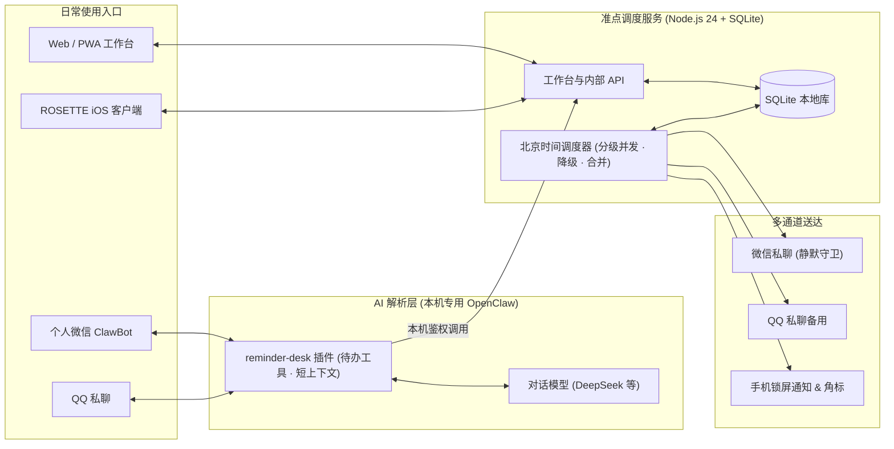

<div align="center">
  
  <h1>ROSETTE</h1>
  <p><strong>个人待办与多通道准点提醒工作台</strong></p>
  <p>在微信里随手发句话建待办，到点通过微信、QQ、iPhone 锁屏通知准时送达，并在网页工作台与原生 iOS 客户端统一管理。</p>
  <p><strong>简体中文</strong> · <a href="./README.en.md">English</a></p>
</div>

---

## 运行前提与 AI 一键部署

> **硬件与网络前提**：ROSETTE 需要后台常驻以维持微信监听与北京时间准点调度，部署前请自备一台 **Linux 云服务器**，或一台**保持联网且 24 小时不断电的电脑 / 迷你主机 / NAS**（如需在 iPhone 上使用主屏幕 PWA 锁屏推送，访问地址需配置有效的 HTTPS 证书）。

### 复制给 Agent 的提示词

在有终端和目标机器访问权限的编程 Agent 中发送下面整段。已有的信息可直接填进提示词。首次接入时，请在安全终端完成模型授权，在手机上扫码绑定微信，并按需授权手机通知。

```text
请实际部署 ROSETTE。从环境检查一直执行到验收和交接。部署、排错和可自动验证的步骤由你执行。等待我操作期间，继续完成其余可执行的步骤。遇到扫码、模型授权、DNS 修改或手机通知授权时，告诉我当前要操作的页面或命令、成功标志以及完成后如何通知你继续。

部署信息（可预填，留空则先从现有环境识别）
- ROSETTE 源码：优先使用本地源码。需要下载时运行 git clone --branch main https://github.com/ZLY123-123/ROSETTE-Reminder.git
- 部署目标：本机 Linux，或 Linux 服务器的 SSH 别名 / 用户名和地址
- 公网 HTTPS 工作台完整地址（含子路径和结尾斜杠，例如 https://example.com/reminder/）：
- OpenClaw 模型供应商和模型（如已有专用实例则沿用其配置）：
- 附加范围：QQ 备用渠道 / iOS 构建（默认只部署网页、微信和 PWA）

1. 优先使用已提供的源码目录，或从给定的 Git 仓库和分支克隆源码。读取 README.md、.env.example、package.json、deploy/ 及 openclaw-plugin/。确认源码版本、目标机系统与架构、SSH 和 sudo 权限、可用端口、现有反代和证书。汇总需要我补充且无法从环境获取的信息，一次问齐。自动安装和服务模板以 Linux + systemd 为基线；若目标机是 Windows 或 NAS，先确认其常驻 Linux 环境和网络入口。升级已有部署时先备份实际数据库、配置和专用网关状态，并记录回滚方法。

2. 安装 Node.js 24、用 npm ci 按锁文件安装依赖，运行 npm test。使用专用低权限服务账户，分开保存程序、数据库与配置。仅在首次部署或字段缺失时生成 APP_PASSWORD、SESSION_SECRET、AGENT_TOKEN 和 VAPID 密钥，配置 VAPID_SUBJECT。保留现有口令、令牌与 VAPID 密钥。凭据只写入受限配置或由我在安全终端输入。交接时给我在本机读取登录口令的命令，报告与日志仅展示路径和状态。

3. 用 deploy/reminder.service 和仓库的 Caddy/Nginx 配置作模板，按目标环境改好路径、权限和端口。按 deploy/README.md 和 deploy/reminder-openclaw.service 配置专用网关。让应用和专用 OpenClaw 网关仅监听回环地址，并交由 systemd 开机启动。APP_ORIGIN 设为 HTTPS 的 scheme + host + 可选端口，子路径在反代配置中处理。子路径部署同时验证 URL 重写、Cookie Path、静态资源、PWA manifest 和 Service Worker 范围。公网反代直接拒绝 /api/agent/*（含子路径下的入口），验证配置后再重载。

4. 为 ROSETTE 单独配置 OpenClaw 的状态目录、端口和工作区。安装前核对兼容组合，以本仓库验证过的 OpenClaw 2026.11.5 和微信插件 @tencent-weixin/openclaw-weixin@2.4.10 为基线。以该专用网关的身份链接 openclaw-plugin，启用 reminder-desk 上下文引擎及其会话钩子，仅开放 reminder_tasks，安装匹配版本的微信适配，并同步 deploy/openclaw/agent-workspace/。两端共享同一专用 OpenClaw 状态目录和网关连接配置，网关的 REMINDER_AGENT_TOKEN 与应用的 AGENT_TOKEN 一致，设置 OPENCLAW_SEND_VIA_GATEWAY=true。若应用端口偏离 3100，同步调整待办插件的 apiBase 并核对微信适配所用的内部地址。通过专用网关的 configure --section model 引导我输入凭据或授权，确认实际生效的供应商和模型。已有有效凭据时直接沿用。

5. 用同一个专用状态目录执行 channels login --channel openclaw-weixin，让我扫码并从本人微信发一条消息。根据绑定记录确定收件人 userId 和机器人 account ID，分别写入 WECHAT_TARGET 和 WECHAT_ACCOUNT，并配置待办插件的收件人及网关的 ownerAllowFrom。发现多个候选或绑定冲突时让我确认目标账号。扫码后继续完成绑定、配置校验和必要的服务重启。QQ 和原生 iOS 仅按我选定的范围处理。接入 QQ 时，按仓库记录使用 QQ 插件 2.0.4，绑定本人私聊 OpenID，验证「测试备用链路」。iOS 的 ReminderAPI.productionURL 使用完整工作台地址，构建和签名按 ios/README.md 处理。

6. 分项验收。确认两个 systemd 服务已运行且开机启用，检查本地和公网 /healthz、有效 HTTPS、网页实际登录和新增待办、外部 /api/agent/* 被反代拦截。让我通过微信发一条两分钟后的签到提醒，核对模型回复、网页待办和处理详情，再核对到点实际收到提醒与投递记录。启用 PWA 时引导我从 iPhone 主屏幕打开工作台，在设置中启用通知，再点「测试手机」核对锁屏通知和角标。结束时清理本次创建的测试待办，保留真实数据。把每项标为通过、待本人验证或受阻，并写出依据。

最后给我一份按本次环境填写的操作流程，涵盖工作台地址、口令读取方式、首次登录、微信创建和修改待办、iPhone 通知设置、投递记录在哪里看，以及查看服务状态、日志、重启、备份和回滚的可复制命令。若有受阻项，附上我需要执行的具体动作和成功标志。
```

---

## 为什么要做 ROSETTE？（核心痛点与解决方案）

日常用微信或 AI 机器人做个人提醒时，往往会撞上几个非常现实的痛点。ROSETTE 正是围绕这些问题打磨出来的：

### 痛点 1：个人微信 ClawBot 有「静默断联」与条数限制，隔天提醒可能被拒收
- **现实问题**：腾讯官方的个人微信机器人通道（ClawBot / iLink）依赖你最近一次发消息产生的会话凭据。会话凭据失效或触发平台限制时，后续定时提醒可能收到 `-2 / prepare failed` 等拒收回执。
- **我的解决方案**：
  1. **静默时长与条数实时守卫**：自动监测距离你上次微信发言的时长与本轮已发条数；静默满 **12 小时**或连续发满 **9 条**时（为通道提示预留下一次发送机会），尝试发一条提醒让你回复**「继续」**刷新通道。
  2. **零成本「继续」秒级续期**：在微信里单发两个字 **「继续」**，系统直接刷新凭据并秒回「微信通道已恢复。」，全程不走大模型、**0 Token 消耗**。
  3. **多通道自动兜底 + 下次对话补报**：如果没来得及续期导致微信拒收，系统会自动暂停微信尝试，无缝切换到 **QQ 私聊**或 **iPhone PWA 锁屏通知**送达，同时写入网页收件箱；等你下次在微信说话时自动恢复通道，并在回复末尾把静默期间错过的微信提醒一次性补报给你。

### 痛点 2：聊天窗「随手记」很爽，但「回头查」和「单通道防漏」很痛苦
- **现实问题**：微信最适合 3 秒钟发一句「明天下午三点取快递」，但待办一多，翻聊天记录就像大海捞针；而且单靠微信一个入口，遇到消息折叠、免打扰或通道异常很容易漏看重要日程。
- **我的解决方案**：
  1. **聊天录入 + 可视化看板实时同步**：微信、QQ、网页端与 iOS App 共用同一份待办库——聊天窗负责快记快改，工作台负责全局筛选、归档整理与核对投递结果。
  2. **三级投递编排 + 重要事项双发**：自由配置微信、QQ、手机PWA通知的先后顺位（逐级备用、多路并发任选）；考试、预约、签退等关键任务开启**「重要事项」**，到点无视顺位同时弹出手机锁屏通知并更新主屏未读角标。

### 痛点 3：靠大模型轮询发提醒既不准时，聊天越长还越烧 Token
- **现实问题**：很多开源 AI 助手在提醒到期时才唤醒大模型去决定发什么，不仅延迟高、模型超时就漏发，而且长期在同一个微信窗口对话会让历史上下文滚雪球到数万 Token，改个简单提醒也要花不少钱；引用旧消息回一句「已完成」还容易改错同名任务。
- **我的解决方案**：
  1. **AI 只管听懂录入，程序负责准点发送**：大模型只参与解析你的自然语言；**到点提醒、每日待办总结、「继续」续期全部由服务端按北京时间准点直发（0 模型调用）**，同一分钟的多条待办自动合并成一条微信消息不刷屏，服务重启也能自动恢复待发任务。
  2. **一键「节省 Token」+ DeepSeek 人民币账单看板**：支持一键开启短上下文模式（仅保留最近两轮对话与当前引用），大幅降低长会话开销；设置页直接查看 DeepSeek 实时人民币余额、峰谷费用估算与低余额预警。
  3. **引用防呆与异常回执**：支持长按引用某条提醒直接说「已完成 / 推迟一小时」精准识别同名事项；若引用原文已过期未缓存，会先追问确认是哪件事，绝不乱改数据；遇到模型空回复或报错也会主动发出提示回执。

---

## 功能全览

### 一、微信 / QQ 聊天助手：发句话就能管好日程

绑定微信或 QQ 后，直接用日常口语和助手对话即可完成以下操作：

| 使用场景 | 你可以直接怎么说 | 实际效果 |
| --- | --- | --- |
| **随手记单次提醒 / 备忘** | `明天下午三点提醒我取快递` / `两小时后喝水` / `记一下买电池` | 自动换算北京时间创建提醒；不带时间的自动归入「待安排」备忘 |
| **带截止日的周期提醒** | `下周一到周五，每晚 10 点提醒我签退` | 创建每天/每周重复任务，到达截止日当天发完最后一次自动结束 |
| **多时段复杂排班日程** | `这周六周日早 9 点和下午 2 点提醒巡检，跳过周日早上` | 按日期区间、星期筛选、补充日期与跳过例外日期批量生成日程，自动去重 |
| **改期、完成、暂停、删除** | `把签退改到晚上 9 点半` / `暂停签退提醒但保留待办` | 按名称智能匹配修改；若存在多个同名任务，会列出候选请你指定 |
| **引用消息快捷操作** | 长按引用某条提醒，回复 `已完成` 或 `顺延一小时` | 根据被引用内容精准定位目标待办，同名周期与单次任务也不会混淆 |
| **查任务与核对送达状态** | `我今天还有什么待办` / `刚才那条提醒发出来了吗` | 按逾期、今天、稍后、待安排分类汇报，或查询微信/QQ/手机实际投递回执 |
| **遥控收件箱、日报与推送** | `清空提醒收件箱` / `撤销刚才清空` / `每天早 8 点半发日报` / `改成微信和手机同时发` | 在聊天窗内直接整理网页收件箱（不影响原待办）、调整日报时间和投递策略 |

微信对话示例。设置签到提醒，到点收到通知，再引用提醒回复「已完成」。

---

### 二、Web / 手机 PWA 工作台：五大视图可视化管理

工作台包含五个核心页面。

#### 1. 概览（Overview）
- 醒目展示**下一条提醒**的名称与北京时间倒计时节点。
- 同屏速览**今日待办**、**未读提醒收件箱**、**微信绑定与最近互动状态**，以及当前生效的投递路由链和已授权手机设备数。

#### 2. 待办（Tasks）
- **智能分组与筛选**：待处理任务自动按 **已到期 · 今天 · 接下来 · 待安排 · 周期已结束** 分组，支持一键切换「待处理 / 今天 / 已完成 / 已归档」。
- **完整表单编辑**：可视化设置事项名称、提醒时间、重复规则（单次 / 每天 / 每周）、截止日期（含当天），以及勾选**「重要事项，手机通知同时发送」**；支持随时编辑、标记完成、归档与恢复。

#### 3. 对话（Conversation）
- **全渠道时间线**：实时同步已绑定微信 / QQ 的聊天消息与穿插其中的定时提醒卡片，支持向上加载历史记录。
- **多媒体附件查看**：直接在网页内预览微信发来的图片，或打开仍在缓存保留期内的音视频附件。
- **消息来源标签**：清晰区分每条回复是 `程序发送`（定时提醒/系统回执）、`AI 生成`，还是 `AI 生成 · 含程序补报`；开启短上下文的回合还会标注 `节省 Token`。
- **可展开「处理详情」**：点开任意微信消息，按时间轴查看网关收件、引用原文核对、模型供应商与响应耗时、实际调用的待办操作、单次输入/输出/缓存 Token 用量及备用渠道投递结果。

#### 4. 提醒（Alerts & Delivery Log）
- **提醒收件箱**：集中留存所有未送达兜底提醒与 PWA 通知记录，未读数实时联动页面角标与 **iPhone 主屏幕图标数字角标**；支持单条标为已读/未读、单条归档、**一键清空收件箱**，以及在归档视图中**一键恢复最近清空的一批提醒**。
- **最近投递日志**：逐条展示历史提醒在微信、QQ、PWA 三端的受理、拒收、待确认状态及具体原因说明。

#### 5. 设置（Settings）
- **OpenClaw 模型热切换与省流开关**：直接在页面选择模型供应商（DeepSeek、OpenAI、Anthropic、Gemini、OpenRouter、Ollama 等）与对话模型，实时开关**「节省 Token」**模式。
- **DeepSeek 账户余额与人民币账单面板**：生效模型为 DeepSeek 时，自动展示人民币/美元实时余额（区分赠金与充值）、配置**低余额收件箱预警阈值**，并提供今天 / 近 7 天 / 30 天 / 90 天的**每日 Token 柱状图**、按模型与渠道拆分统计，以及结合北京时间峰谷单价与节假日算出的**人民币预估费用**。
- **投递顺序自由编排**：内置「微信优先」「逐级备用」「三路并发」快捷预设，也可单独将微信、QQ、手机通知设为第一/二/三级或关闭，并选择降级触发条件（「全部未获受理」或「仅明确失败」）。
- **微信发送观察 & 链路测试**：实时查看最近入站时刻、当前静默时长、本轮微信已受理条数；支持一键启用本机通知、点击**「测试手机」**验证锁屏与角标、点击**「测试备用链路」**模拟微信拒收以检验 QQ 与手机兜底，以及设置**每日待办总结**推送时间。

---

### 三、原生 SwiftUI iOS 客户端（`ios/`，支持 iOS 17+）

除网页与主屏幕 PWA 外，仓库还提供原生 SwiftUI 客户端，与网页和微信共用同一套口令与数据，额外支持离线缓存浏览、未来 14 天 iOS 本机定时通知、导入系统日历、系统「快捷指令」及对话多媒体预览。详见 [ROSETTE iOS 说明](./ios/README.md)。

---

## 核心架构简述



1. **读写职责分离**：OpenClaw 仅在收到聊天消息时通过受限的 `reminder_tasks` 工具读写待办；定时扫描、周期推进、日报生成与失败重试均由 Node.js 服务独立完成，保障准点率与零空转功耗。
2. **极简自托管依赖**：后端使用 Node.js 24 内置 `node:http` 与 `node:sqlite`，运行时仅依赖 `web-push` 一个第三方包，单机单库即可稳定常驻。
3. **严格权限隔离**：公网反向代理仅暴露工作台页面与登录会话接口，内部机器人接口 `/api/agent/*` 仅允许本机 OpenClaw 网关凭令牌访问，工具层同时强校验本人微信/QQ 身份。

---

## 快速开始（本机体验）

需要安装 **Node.js >= 24**（搭配 OpenClaw `2026.11.5` 建议使用 **Node.js 24.16.0+**）。

```bash
# 1. 安装依赖
npm ci

# 2. 启动本机内存预览模式（免配置，终端会直接打印本次随机登录口令）
npm run preview

# 3. 运行自动化测试套件
npm test
```

打开浏览器访问 `http://localhost:3176` 输入终端打印的口令即可体验完整网页工作台。

---

## 自托管部署与渠道接入

### 1. 配置环境变量与启动服务

1. 复制 [`.env.example`](./.env.example) 为 `.env`，设置外部访问地址 `APP_ORIGIN=https://你的域名` 与登录口令 `APP_PASSWORD`（至少 12 位）。
2. 生成两个 32 字节随机值分别填入 `SESSION_SECRET` 和 `AGENT_TOKEN`：
   ```bash
   node -e "console.log(require('node:crypto').randomBytes(32).toString('hex'))"
   ```
3. 运行 `npm run keys` 生成一套 Web Push 密钥填入 `VAPID_PUBLIC_KEY`、`VAPID_PRIVATE_KEY`，并将 `VAPID_SUBJECT` 设为 `mailto:你的邮箱`。
4. 使用 `npm start` 启动服务，生产环境可配合 [`deploy/reminder.service`](./deploy/reminder.service)（systemd）及 [`deploy/Caddyfile`](./deploy/Caddyfile) 或 [`deploy/nginx-subpath.conf`](./deploy/nginx-subpath.conf) 配置 HTTPS 反代（务必在公网反代层拦截 `/api/agent/*`）。

### 2. 接入微信与 QQ 渠道

在专用的本机 OpenClaw 实例中安装经过项目验证的官方渠道插件（微信 `2.4.10`、QQ `2.0.4`）：

```bash
openclaw plugins install npm:@tencent-weixin/openclaw-weixin@2.4.10 --accept-capabilities
openclaw channels login --channel openclaw-weixin
openclaw plugins install npm:@tencent-connect/openclaw-qqbot@2.0.4 --accept-capabilities
openclaw gateway restart
openclaw channels status
```

- **微信绑定**：按 [腾讯微信插件说明](https://github.com/Tencent/openclaw-weixin/blob/main/README.md) 扫码并从个人微信发一条消息后，从状态目录 `openclaw-weixin/accounts/` 中提取你的 `userId`（`xxx@im.wechat`）填入 `.env` 的 `WECHAT_TARGET`，账号名填入 `WECHAT_ACCOUNT`，建议同时开启 `OPENCLAW_SEND_VIA_GATEWAY=true`。Linux 服务器可按[部署手册](./deploy/README.md)应用微信适配，启用回合处理追踪和「继续」指令。
- **QQ 绑定（可选）**：按 [腾讯 QQ Bot 插件说明](https://github.com/tencent-connect/openclaw-qqbot/blob/main/README.zh.md) 配置机器人并私聊 `/bot-me` 获取 OpenID 填入 `QQ_TARGET`，限制私聊白名单为本人。

### 自然语言待办

在同一个专用 OpenClaw 网关中安装仓库自带的待办与短上下文插件：

```bash
openclaw plugins install --link ./openclaw-plugin --force --accept-capabilities
openclaw config set plugins.entries.reminder-desk.enabled true
openclaw config set plugins.slots.contextEngine reminder-desk
openclaw config set plugins.entries.reminder-desk.hooks.allowConversationAccess true --strict-json
openclaw config set plugins.entries.reminder-desk.config.wechatSender '你的微信用户ID'
openclaw config set plugins.entries.reminder-desk.config.wechatAccount '你的微信机器人AccountID'
openclaw config set plugins.entries.reminder-desk.config.qqSender '你的QQ机器人OpenID'
```

在网关环境中配置与服务端一致的 `REMINDER_AGENT_TOKEN`，将你的微信/QQ ID 加入 `commands.ownerAllowFrom`，并将 `tools.allow` 设为 `["reminder_tasks"]`（助手提示词可直接使用 [`deploy/openclaw/agent-workspace/AGENTS.md`](./deploy/openclaw/agent-workspace/AGENTS.md)）。重启网关后即可开始对话。

### 3. iPhone 端使用（PWA 与原生客户端）

- **主屏幕 PWA**：iOS 16.4+ 用 Safari 打开 HTTPS 站点 → **分享 → 添加到主屏幕** → 从桌面图标打开登录 → 进入「设置 → 手机通知」点击**「在本机启用」**。
- **原生 SwiftUI App**：将 [`ios/Core/ReminderAPI.swift`](./ios/Core/ReminderAPI.swift) 中的 `ReminderAPI.productionURL` 改为你的 HTTPS 服务地址（如需自定义 Bundle ID，同步修改 [`ios/project.yml`](./ios/project.yml)），之后通过本地 Xcode 或仓库自带的 GitHub Actions 工作流（[`.github/workflows/ios.yml`](./.github/workflows/ios.yml)）构建即可。详见 **[ROSETTE iOS 说明](./ios/README.md)**。

---

## 项目目录

- `src/`：Node.js 后端核心（HTTP/API、SQLite 存储、分级投递调度、微信静默窗口与模型用量统计）
- `public/`：Web / PWA 前端资源（页面、Service Worker、图标与字体）
- `openclaw-plugin/`：OpenClaw 专用插件（`reminder_tasks` 待办工具与短上下文引擎）
- `ios/`：SwiftUI 原生 iOS 客户端源码、SwiftPM 核心包与构建脚本
- `deploy/`：systemd 服务文件、Caddy / Nginx 反向代理配置与网关适配脚本
- `test/`：自动化测试套件

---

## 开源协议

项目源码采用 [MIT License](./LICENSE)。随附字体适用各自的 SIL Open Font License，详见 [Web 字体目录](./public/fonts/)与 [iOS 字体目录](./ios/Resources/Fonts/)。

---

## 免责声明

- **使用范围与合规**：本项目面向个人学习、技术研究和自托管日常提醒。接入微信、QQ 等渠道及第三方模型服务时，请严格遵守各平台的服务协议与使用规范，因配置不当或违规使用引发的账号风控、限制等问题由使用者自行承担。
- **微信通道与网关改造说明**：本项目的微信连接基于腾讯面向原生 OpenClaw 提供的官方微信 ClawBot 插件通道，但在此基础上部署了独立专用网关，并对插件的入站标识、回执追踪与「继续」指令流程进行了本地适配修改，由外部调度服务通过网关触发主动提醒。接入前请核对平台现行服务条款。长期兼容性和送达以平台规则及实际回执为准。
- **第三方声明**：本项目为独立开源项目，与腾讯（微信 / QQ）、Apple、OpenClaw、DeepSeek 及文中提及的其他第三方品牌或服务商无任何隶属、合作或官方背书关系。
- **无担保与风险提示**：本软件按「原样（AS IS）」提供，不作任何可用性、准确性或送达率担保。消息的实际触达受服务器状态、网络环境、平台通道限制、手机系统通知权限与专注模式等因素共同影响；工作台显示的模型用量为本地估算值，实际计费以供应商官方账单为准。请勿将本项目作为医疗用药、生命安全、金融交易或其他高风险场景的唯一提醒手段，开发者不对因提醒延迟、漏发、AI 语义解析偏差或数据丢失造成的任何直接或间接损失承担责任。
